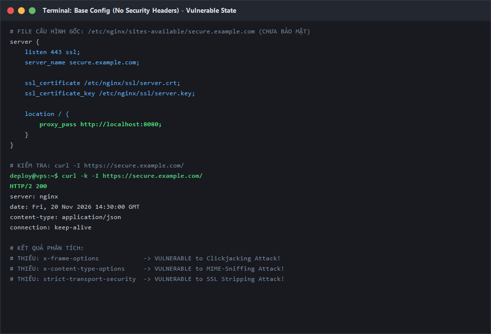
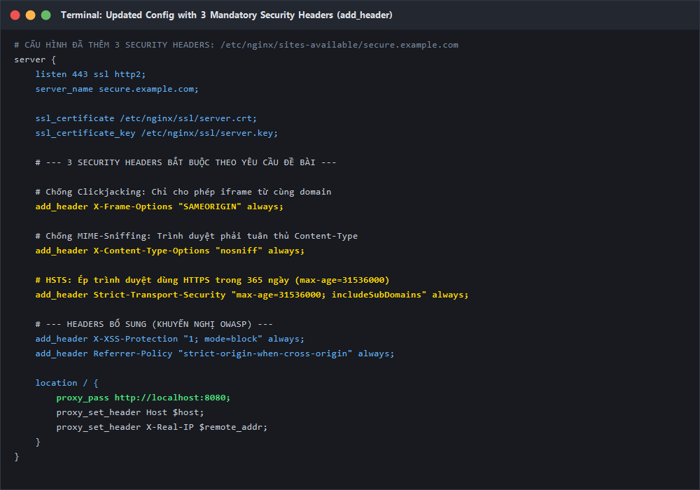
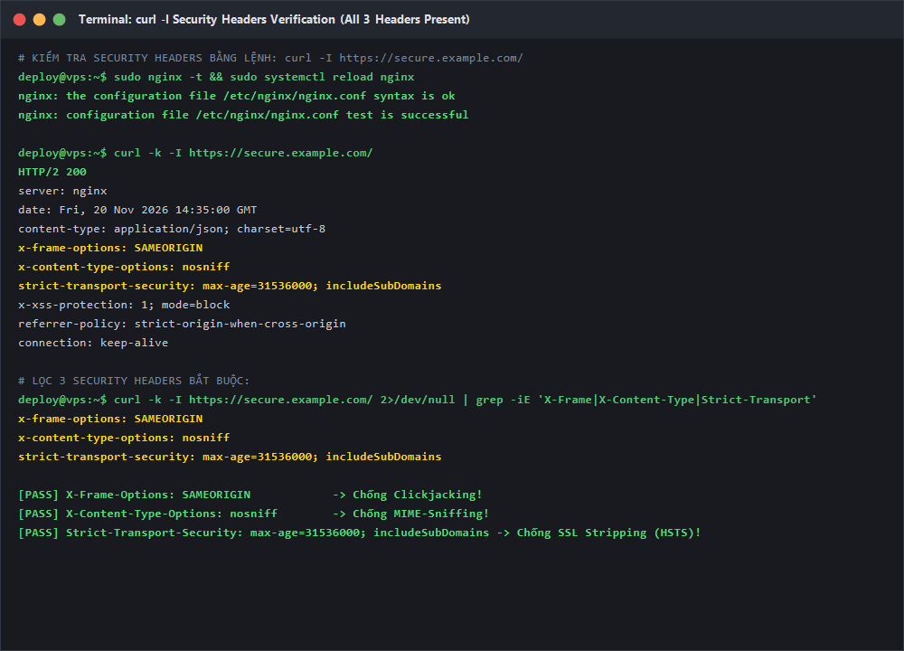

# Session 12 - Bài tập 3: Cấu hình Header Security (Vận dụng chuyên sâu)

Dự án bổ sung các **HTTP Security Headers** vào cấu hình Nginx để bảo vệ ứng dụng E-commerce HTTPS khỏi các tấn công web phổ biến: **Clickjacking**, **MIME-Sniffing**, và **SSL Stripping Attack (HSTS)**.

---

## 📋 Mục lục
1. [Mục tiêu và Tình huống nghiệp vụ](#1-mục-tiêu-và-tình-huống-nghiệp-vụ)
2. [Giải thích 3 Security Headers bắt buộc](#2-giải-thích-3-security-headers-bắt-buộc)
3. [File cấu hình gốc và File đã thêm Security Headers](#3-file-cấu-hình-gốc-và-file-đã-thêm-security-headers)
4. [Lệnh `curl -I` kiểm tra headers trả về từ máy chủ](#4-lệnh-curl--i-kiểm-tra-headers-trả-về-từ-máy-chủ)
5. [Cấu trúc thư mục dự án](#5-cấu-trúc-thư-mục-dự-án)
6. [Hình ảnh minh chứng thực hành](#6-hình-ảnh-minh-chứng-thực-hành)

---

## 1. Mục tiêu và Tình huống nghiệp vụ

* **Mục tiêu kiến thức:**
  * Hiểu và cấu hình các HTTP Security Headers theo tiêu chuẩn OWASP.
  * Bảo vệ ứng dụng khỏi các tấn công web phổ biến: XSS, Clickjacking, MIME-Sniffing.
* **Tình huống nghiệp vụ:**
  * Đội Security đã scan hệ thống và phát hiện server HTTPS `secure.example.com` thiếu các Security Headers quan trọng. Yêu cầu Nginx phải trả về 3 headers bảo mật trong mọi HTTP response.

---

## 2. Giải thích 3 Security Headers bắt buộc

### 2.1 `X-Frame-Options: SAMEORIGIN` → Chống Clickjacking

**Clickjacking** là kiểu tấn công kẻ xấu nhúng trang web của bạn vào một `<iframe>` ẩn trên trang độc hại, và overlay các phần tử UI lên trên, lừa người dùng vô tình click vào các hành động nguy hiểm (xác nhận chuyển tiền, thay đổi mật khẩu).

```nginx
add_header X-Frame-Options "SAMEORIGIN" always;
```

| Giá trị | Ý nghĩa |
| :--- | :--- |
| `DENY` | Cấm hoàn toàn nhúng trang vào iframe từ bất kỳ nguồn nào. |
| **`SAMEORIGIN`** ← Đề bài yêu cầu | Chỉ cho phép nhúng iframe khi trang cha **cùng domain**. |

---

### 2.2 `X-Content-Type-Options: nosniff` → Chống MIME-Sniffing

**MIME-Sniffing Attack:** Trình duyệt cũ (đặc biệt Internet Explorer) có tính năng "đoán lại" loại file (MIME type) dựa vào nội dung byte của file, bỏ qua header `Content-Type` mà server gửi về. Kẻ tấn công có thể lợi dụng bằng cách upload file "avatar.jpg" nhưng thực tế chứa mã JavaScript. Trình duyệt MIME-sniff thấy tag `<script>` trong file và thực thi dưới dạng JavaScript → tấn công **XSS (Cross-Site Scripting)**.

```nginx
add_header X-Content-Type-Options "nosniff" always;
```

Với header `nosniff`, trình duyệt bắt buộc phải tin tuyệt đối vào `Content-Type` mà server cung cấp, không được tự "đoán" lại.

---

### 2.3 `Strict-Transport-Security: max-age=31536000; includeSubDomains` → HSTS (Chống SSL Stripping)

**SSL Stripping Attack:** Kẻ tấn công ngăn trình duyệt tạo kết nối HTTPS, ép người dùng giao tiếp bằng HTTP không mã hóa để nghe lén dữ liệu (Man-in-the-Middle). Người dùng gõ `http://secure.example.com`, kẻ tấn công "dịch" thành HTTPS khi kết nối tới server nhưng vẫn giao tiếp HTTP với người dùng.

```nginx
add_header Strict-Transport-Security "max-age=31536000; includeSubDomains" always;
```

| Tham số | Ý nghĩa |
| :--- | :--- |
| `max-age=31536000` | Trình duyệt nhớ chỉ dùng HTTPS trong 365 ngày. Mọi request HTTP đều bị chuyển thành HTTPS **ngay trên máy client** trước khi ra mạng → Kẻ tấn công không có cơ hội can thiệp. |
| `includeSubDomains` | Áp dụng bảo vệ HSTS cho tất cả subdomain: `api.`, `admin.`, `mail.`... |

> ⚠️ **Lưu ý:** Header này chỉ có hiệu lực khi được gửi qua kết nối HTTPS hợp lệ. Nếu gửi qua HTTP, trình duyệt sẽ bỏ qua hoàn toàn.

---

## 3. File cấu hình gốc và File đã thêm Security Headers

### File GỐC (Chưa có Security Headers):
```nginx
server {
    listen 443 ssl;
    server_name secure.example.com;

    ssl_certificate /etc/nginx/ssl/server.crt;
    ssl_certificate_key /etc/nginx/ssl/server.key;

    location / {
        proxy_pass http://localhost:8080;
    }
}
```

### File ĐÃ THÊM Security Headers đầy đủ:
```nginx
server {
    listen 443 ssl http2;
    listen [::]:443 ssl http2;
    server_name secure.example.com;

    ssl_certificate /etc/nginx/ssl/server.crt;
    ssl_certificate_key /etc/nginx/ssl/server.key;
    ssl_protocols TLSv1.2 TLSv1.3;

    # --- 3 SECURITY HEADERS BẮT BUỘC THEO YÊU CẦU ĐỀ BÀI ---

    # Chống Clickjacking
    add_header X-Frame-Options "SAMEORIGIN" always;

    # Chống MIME-Sniffing
    add_header X-Content-Type-Options "nosniff" always;

    # HSTS - Chống SSL Stripping Attack
    add_header Strict-Transport-Security "max-age=31536000; includeSubDomains" always;

    # --- HEADERS BỔ SUNG (KHUYẾN NGHỊ OWASP) ---
    add_header X-XSS-Protection "1; mode=block" always;
    add_header Referrer-Policy "strict-origin-when-cross-origin" always;
    add_header Content-Security-Policy "default-src 'self'; script-src 'self'; style-src 'self' 'unsafe-inline'; img-src 'self' data: https:;" always;

    server_tokens off;

    location / {
        proxy_pass http://localhost:8080;
        proxy_http_version 1.1;
        proxy_set_header Host $host;
        proxy_set_header X-Real-IP $remote_addr;
        proxy_set_header X-Forwarded-For $proxy_add_x_forwarded_for;
        proxy_set_header X-Forwarded-Proto $scheme;
    }
}

server {
    listen 80;
    server_name secure.example.com;
    return 301 https://$host$request_uri;
}
```

---

## 4. Lệnh `curl -I` kiểm tra headers trả về từ máy chủ

```bash
# Kiểm tra toàn bộ response headers:
curl -k -I https://secure.example.com/

# Lọc xem chính xác 3 security headers yêu cầu:
curl -k -I https://secure.example.com/ 2>/dev/null | \
  grep -iE "X-Frame-Options|X-Content-Type-Options|Strict-Transport-Security"
```

**Kết quả mong muốn khi cấu hình đúng:**
```http
HTTP/2 200
x-frame-options: SAMEORIGIN
x-content-type-options: nosniff
strict-transport-security: max-age=31536000; includeSubDomains
```

---

## 5. Cấu trúc thư mục dự án

```
.
├── commands.txt                                # Giải thích headers + lệnh curl kiểm tra
├── docker-compose.yml                          # Môi trường test Nginx HTTPS + Backend Mock
├── EXPLANATION.md                              # Báo cáo chuyên sâu về cơ chế tấn công & phòng thủ
├── README.md                                   # Tài liệu chính của bài tập
├── nginx/
│   ├── nginx.conf                              # Cấu hình chính Nginx
│   └── sites-available/
│       ├── secure.example.com.base            # Cấu hình GỐC (Chưa có security headers)
│       └── secure.example.com                 # Cấu hình ĐÃ THÊM đầy đủ security headers
├── scripts/
│   └── check-security-headers.sh              # Script curl -I kiểm tra headers
└── homework/
    └── session_12/
        └── exercise_03/
            ├── nginx_config_base_no_headers_proof.png  # Cấu hình gốc chưa có security headers
            ├── nginx_config_with_headers_proof.png     # Cấu hình đã thêm 3 headers
            └── curl_security_headers_verification_proof.png # curl -I xác nhận headers
```

---

## 6. Hình ảnh minh chứng thực hành

### 1. Cấu hình gốc KHÔNG có Security Headers (Dễ bị tấn công):


### 2. Cấu hình đã thêm đầy đủ 3 Security Headers bắt buộc:


### 3. Kết quả `curl -I` xác nhận Security Headers trả về từ máy chủ:

